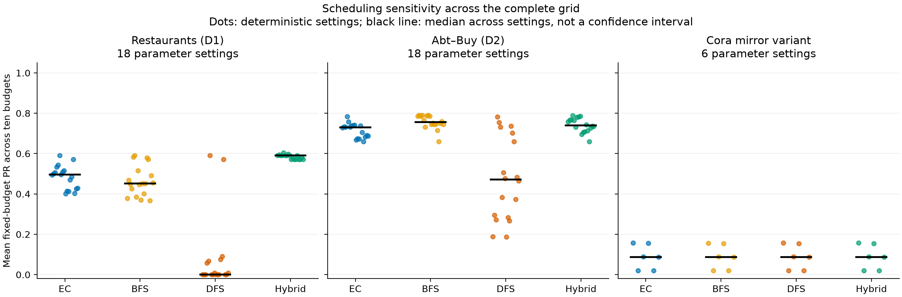
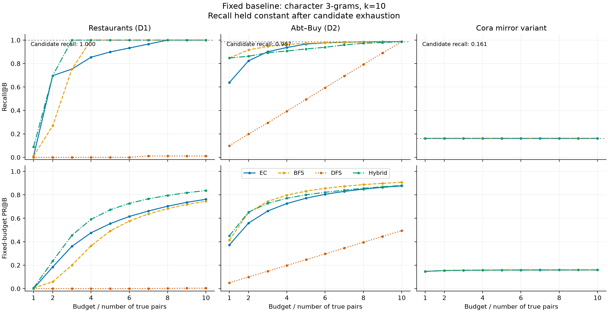
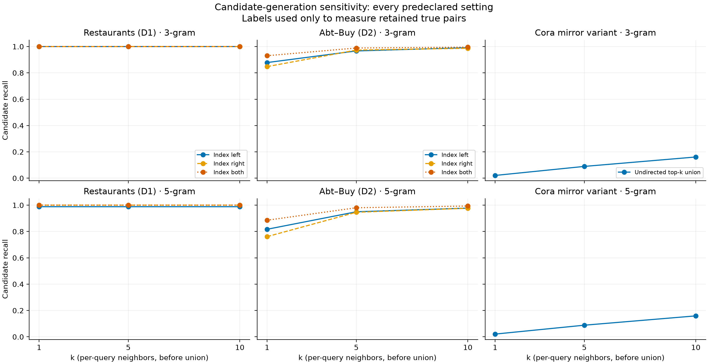
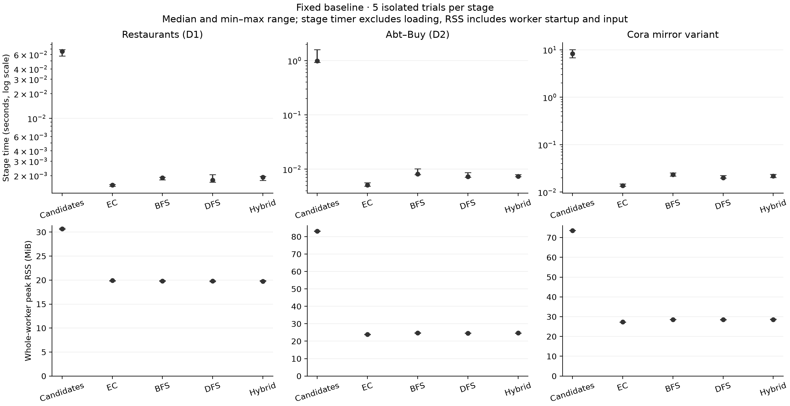

# Parameter sensitivity and resource measurements

## Scope and protocol

We executed all 42 predeclared candidate configurations: 18 each for D1 and D2
(3/5-grams × k=1/5/10 × left/right/both indexing), and six for the Cora mirror
variant (3/5-grams × k=1/5/10, undirected union). Each configuration uses the
same candidates and weights for EC, BFS, DFS and Hybrid, with ten budgets
B=i×|truth|. This produces 1,680 metric rows. Scheduling remains on the left
partition for linkage, so changing indexing isolates candidate generation
rather than jointly changing the scheduling partition.

The grid is descriptive sensitivity analysis. We do not choose a winning setting
on these labels and claim independent validation. Every setting is reported.

Protocol: [experiment_protocol.json](../configs/experiment_protocol.json).
Full results: [sweep_metrics.csv](sweep_metrics.csv); source/input/config hashes:
[sweep_manifest.json](sweep_manifest.json).

## Scheduling sensitivity

For each setting we average fixed-budget PR across its ten budgets. The table
summarizes those setting-level means. The ranges are variation across chosen
parameters, not sampling uncertainty, confidence intervals, or independent replicates.

| Dataset | Strategy | Settings | Minimum | Median | Maximum |
| --- | --- | ---: | ---: | ---: | ---: |
| d1_restaurants | EC | 18 | 0.4014 | 0.4954 | 0.5903 |
| d1_restaurants | BFS | 18 | 0.3670 | 0.4524 | 0.5903 |
| d1_restaurants | DFS | 18 | 0.0000 | 0.0010 | 0.5903 |
| d1_restaurants | Hybrid | 18 | 0.5711 | 0.5903 | 0.6037 |
| d2_abt_buy | EC | 18 | 0.6590 | 0.7303 | 0.7838 |
| d2_abt_buy | BFS | 18 | 0.6590 | 0.7555 | 0.7905 |
| d2_abt_buy | DFS | 18 | 0.1865 | 0.4708 | 0.7818 |
| d2_abt_buy | Hybrid | 18 | 0.6590 | 0.7402 | 0.7883 |
| cora_large_variant | EC | 6 | 0.0206 | 0.0876 | 0.1569 |
| cora_large_variant | BFS | 6 | 0.0206 | 0.0875 | 0.1564 |
| cora_large_variant | DFS | 6 | 0.0206 | 0.0876 | 0.1567 |
| cora_large_variant | Hybrid | 6 | 0.0206 | 0.0876 | 0.1567 |





## Candidate ceiling and diagnostic cases

The candidate-recall ceiling is evaluated against all unique positive pairs.
A scheduler cannot recover positives discarded before scheduling.

| Dataset | n-gram | k | Indexing | Candidate pairs | Candidate recall |
| --- | ---: | ---: | --- | ---: | ---: |
| d1_restaurants | 3 | 1 | right | 339 | 1.0000 |
| d1_restaurants | 3 | 10 | right | 3390 | 1.0000 |
| d2_abt_buy | 3 | 10 | right | 10760 | 0.9870 |
| d2_abt_buy | 3 | 10 | both | 14808 | 0.9954 |
| cora_large_variant | 3 | 1 | right | 1402 | 0.0208 |
| cora_large_variant | 3 | 5 | right | 6652 | 0.0894 |
| cora_large_variant | 3 | 10 | right | 13079 | 0.1609 |
| cora_large_variant | 5 | 10 | right | 13115 | 0.1590 |



**D1 diagnostic:** in the fixed k=10 baseline, 78 of the first 89 EC pairs
have cosine above 0.999999, yet only 1 of those 89 comparisons is a true pair.
This is a concrete example of highly similar sparse profiles creating ambiguous
priorities. It explains why a perfect-looking similarity score is not proof of
entity identity. It does not by itself isolate the effect of preprocessing or tie-breaking.

**Abt–Buy:** bilateral candidate generation increases recall at k=10 in the
3-gram setting, but also changes the number of candidates and scheduling cost.
This is a candidate-set trade-off, not an isolated improvement in the scheduler.

**Cora:** the candidate ceiling rises with k and remains about 16% at k=10.
Switching from 3-grams to 5-grams does not resolve that limitation in this grid.
All ten configured budgets exceed the generated candidate count, so ordinary
recall is flat across those budgets. Differences in fixed-budget PR mainly
reflect the within-candidate ordering plus the explicit constant tail; they
must not be confused with improvements in final recall.

## Timing and memory

Resource trials use the previously fixed 3-gram, k=10, right-index baseline.
One warm-up block is discarded, followed by five measured blocks. Each block
shuffles all 15 dataset-stage jobs using seed 5003 and executes them sequentially.
Each job starts a fresh Python process with fixed PYTHONHASHSEED. Warm-up warms
OS-level caches; it does not reuse a warmed Python interpreter.

Stage timers exclude process startup, imports, input loading, output hashing,
and serialization. Candidate workers load source records; scheduler workers
load an identical serialized candidate snapshot and schedule at the maximum
configured budget. Every worker's output signature is checked against a
reference result before accepting the observation.

Memory is full-worker lifetime peak RSS through the stage, normalized from
platform-specific getrusage units to bytes. It includes interpreter, imports,
input parsing, and the input object graph. It is **not incremental algorithm
memory**, and candidate/scheduler workers have different input baselines.

| Dataset | Stage | Trials | Median time (ms) | Min–max time (ms) | Median peak RSS (MiB) | Min–max RSS (MiB) |
| --- | --- | ---: | ---: | --- | ---: | --- |
| cora_large_variant | BFS | 5 | 23.52 | 21.97–25.43 | 28.58 | 28.48–28.67 |
| cora_large_variant | DFS | 5 | 20.15 | 19.90–22.60 | 28.48 | 28.39–28.64 |
| cora_large_variant | EC | 5 | 13.70 | 13.26–14.99 | 27.34 | 27.19–27.42 |
| cora_large_variant | Hybrid | 5 | 21.76 | 20.45–23.82 | 28.59 | 28.55–28.86 |
| cora_large_variant | candidates | 5 | 8305.94 | 6841.10–10154.13 | 73.62 | 73.53–73.77 |
| d1_restaurants | BFS | 5 | 1.88 | 1.78–1.91 | 19.83 | 19.73–19.92 |
| d1_restaurants | DFS | 5 | 1.76 | 1.67–2.05 | 19.83 | 19.66–19.86 |
| d1_restaurants | EC | 5 | 1.53 | 1.48–1.56 | 19.91 | 19.78–19.91 |
| d1_restaurants | Hybrid | 5 | 1.91 | 1.76–1.96 | 19.75 | 19.73–19.92 |
| d1_restaurants | candidates | 5 | 65.91 | 57.53–69.17 | 30.70 | 30.56–30.81 |
| d2_abt_buy | BFS | 5 | 8.16 | 7.96–10.21 | 24.75 | 24.62–24.92 |
| d2_abt_buy | DFS | 5 | 7.29 | 7.13–8.63 | 24.59 | 24.55–24.78 |
| d2_abt_buy | EC | 5 | 5.13 | 4.84–5.66 | 23.84 | 23.69–24.12 |
| d2_abt_buy | Hybrid | 5 | 7.39 | 7.28–8.00 | 24.75 | 24.59–24.80 |
| d2_abt_buy | candidates | 5 | 983.20 | 933.24–1602.63 | 83.11 | 83.03–83.39 |



Intervals are observed min–max ranges across five trials, not confidence
intervals. Timings reflect this machine and its current background load. No
cross-machine speedup, superiority over published code, or statistical significance
is claimed. See [raw measurements](resource_measurements.csv),
[summary](resource_summary.csv), and [protocol/environment/hash manifest](resource_manifest.json).

## Relation to the paper

Paper §7.3 reports strong BFS results on D2 and a different outcome on D1,
using the best configurations per scheduling method. Our fixed baseline and
complete-grid sensitivity test a different controlled question: scheduling on
the same candidate graph within each setting. The paper's overall best Join
workflow uses character 5-grams, TF-IDF, Euclidean similarity and five neighbors;
our implementation uses cosine and smoothed joint-corpus IDF. The paper's
dependency revision is unpinned in the supplied archive, and its Hybrid text
differs from the currently pinned library code. Cora also uses a mirror variant.

Some qualitative behavior is compatible with the paper, but the ranking is
not universally reproduced: on our D2 fixed baseline Hybrid has greater PR
than BFS, and on D1 DFS performs poorly at k=10. A direct numerical claim
would require matching data bytes, candidate generation, indexing/scheduling
context, integration convention, and software version. These results do not
establish that match. See [the source audit](../docs/replication_audit.md).

## Remaining work

- Resolve original dataset/software provenance and dataset-specific terms where possible.
- If pursuing direct published-number reproduction, add matched weighting/similarity and exact reference settings before making that claim.
- Finish clean-environment validation, team contribution information, final report, and video.
- Treat automatic strategy selection or budget-aware scheduling as optional future work with a separate evaluation protocol.

## Reproduce this stage

```bash
python3 scripts/run_sweep.py
python3 scripts/benchmark_resources.py
# Plotting uses Python 3.12 and requirements_plotting.txt; core experiments use stdlib only.
uv venv .venv_plot --python 3.12
uv pip install --python .venv_plot/bin/python -r requirements_plotting.txt
.venv_plot/bin/python scripts/plot_results.py
python3 scripts/summarize_stage2.py
```
